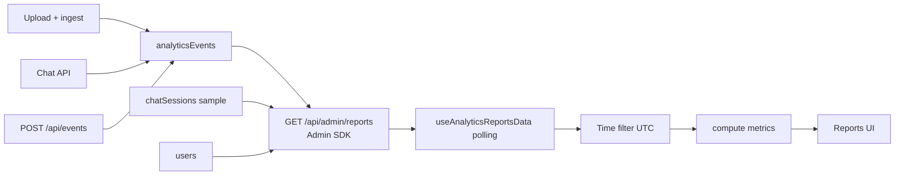

# Analytics Reports

Dashboard telemetry nội bộ tại `/admin/reports` — tài khoản `role: "admin"` hoặc `role: "contributor"`. Tài liệu này mô tả nguồn dữ liệu, cách tải/lọc, các chỉ số trên UI và file code liên quan.

Tổng quan kiến trúc app: [PROJECT_OVERVIEW.md](./PROJECT_OVERVIEW.md).

---

## Truy cập và bảo mật

- **Đường dẫn:** Sidebar → **Analytics Reports** (`/admin/reports`).
- **Client:** `ProtectedRoute` với `allowedRoles={["admin", "contributor"]}` (`src/app/admin/reports/page.tsx`).
- **Server:** UI không đọc Firestore trực tiếp — gọi `GET /api/admin/reports` (bearer token), route này dùng `requireContributorOrAdmin()` rồi query Firestore bằng **Admin SDK** (`src/lib/reports/fetch-analytics-reports-server.ts`), bỏ qua client Firestore rules.
- **Firestore rules:** `analyticsEvents` cho phép `admin`/`contributor` đọc (defense-in-depth — không phải đường đi dữ liệu thật, vì UI không gọi client SDK trực tiếp). User thường (`role: "user"`) không vào được trang; `GET /api/admin/reports` trả `403` nếu role sai.

---

## Collection `analyticsEvents`

Mỗi document:

| Field | Mô tả |
| --- | --- |
| `eventName` | Loại sự kiện (bảng dưới) |
| `payload` | Object tuỳ loại (thường có `user_id`) |
| `createdAt` | Server timestamp khi ghi |

**Quy tắc ghi:** chỉ server (Admin SDK) được `create`; client **không** ghi trực tiếp Firestore (`firestore.rules`: `write: false`).

### Các loại event

| `eventName` | Nguồn ghi | Payload chính |
| --- | --- | --- |
| `file_uploaded` | Client → `POST /api/events` (sau upload Storage, từ `/admin/upload`) | `file_type`, `size`, `user_id` |
| `parse_success` | Server → `/api/ingest` | `rule_count_extracted`, `latency_ms`, `user_id` |
| `parse_failed` | Server → `/api/ingest` (extraction lỗi) | `error_type` (`ai_extraction` \| `docx_parse`), `latency_ms`, `user_id` |
| `query_sent` | Server → `/api/chat` | `query_text`, `type` (`guideline` \| `microcopy`), `scope_message_type` (nullable, xem `MessageType` trong `src/lib/chat/scope-options.ts`), `scope_ui_pattern` (nullable, `UiPattern`), `user_id` |
| `response_delivered` | Server → `/api/chat` (sau stream xong) | `response_type`, `relevance_score`, `latency_ms`, `referenced_sources[]`, `session_id`, `model` (model chat thực sự trả lời, sau fallback), `llm_usage[]` (`{step, model, input_tokens, output_tokens}` cho từng lần gọi Gemini: `chat`, `rewrite`, `relevance`), `prototype_pattern` (`UiPattern` hoặc `null` khi không có bản dựng minh hoạ), `user_id` |
| `user_feedback` | Client → `POST /api/events` (nút 👍/👎 trên `/chat`) | `feedback` (`thumbs_up` \| `thumbs_down`), `session_id`, `message_id`, `user_id` |
| `session_started` | Client → `POST /api/events` (tin chat đầu tạo session) | `session_id`, `user_id` |
| `session_ended` | Client → `POST /api/events` (unmount `/chat` hoặc idle 10 phút) | `session_id`, `duration_ms`, `query_count`, `user_id` |
| `response_copied` | Client → `POST /api/events` (nút copy câu trả lời) | `session_id`, `message_id`, `user_id` |
| `document_viewed` | Client → `POST /api/events` (mở preview tài liệu trong thư viện) | `doc_id`, `file_name`, `user_id` |
| `attachment_uploaded` | Server → `/api/chat/attachments` (ảnh đính kèm chat) | `session_id`, `file_type`, `size`, `user_id` |

**Phân loại query:** `inferQueryType()` trong `src/lib/analytics-events.ts` — heuristic từ khóa (microcopy, toast, button, …); mặc định `guideline`.

**Relevance score:** `estimateRelevanceScore()` — overlap token đơn giản giữa câu hỏi và câu trả lời (0–1), không phải đánh giá LLM.

**API client telemetry:** `POST /api/events` whitelist 6 event trong `CLIENT_ANALYTICS_EVENTS` (`src/lib/analytics-events.ts`): `file_uploaded`, `user_feedback`, `session_started`, `session_ended`, `response_copied`, `document_viewed`. Các event còn lại (`parse_success`, `parse_failed`, `query_sent`, `response_delivered`, `attachment_uploaded`) ghi từ server trong `/api/ingest`, `/api/chat`, `/api/chat/attachments`.

---

## Luồng dữ liệu (telemetry → dashboard)

1. Upload tài liệu → `file_uploaded`.
2. Ingest thành công → `parse_success`.
3. Chat → `query_sent`, sau stream → `response_delivered`.
4. 👍/👎 → `user_feedback`; copy câu trả lời → `response_copied`.
5. Phiên chat: tin đầu → `session_started`; rời trang / idle 10 phút → `session_ended`.
6. Trang reports **tải dữ liệu** qua `GET /api/admin/reports` (polling, **không** dùng `onSnapshot`); route server dùng Admin SDK để đọc `analyticsEvents` (500 mới nhất), `users` (mọi doc có `createdAt`), `chatSessions` (300 mới nhất):
   - Khi admin/contributor mở trang: gọi hook `useAnalyticsReportsData` → fetch API trên.
   - **Tự động mỗi 6 giờ** (`REPORTS_AUTO_REFRESH_MS` trong hook).
   - Nút **Cập nhật** gọi cùng hàm fetch; hiển thị `Cập nhật lúc: …` (locale `vi-VN`).
7. **Bộ lọc thời gian** (client-side, **UTC**):
   - **Hôm nay** — từ 00:00 UTC ngày hiện tại.
   - **7 ngày** / **30 ngày** — rolling window từ thời điểm hiện tại.
   - Event: lọc theo `createdAt`. Session: lọc theo `updatedAt` (fallback max timestamp của mọi tin nhắn nếu thiếu `updatedAt`).
8. **Chi tiết user:** nhấn dòng trong Top users → `UserAnalyticsDetailModal` dùng **cùng** tập event đã lọc.

### Giới hạn mẫu

| Nguồn | Limit | Ghi chú |
| --- | --- | --- |
| `analyticsEvents` | 500 | `orderBy createdAt desc` |
| `chatSessions` | 300 | `orderBy updatedAt desc` |
| `users` | (không giới hạn) | `orderBy createdAt desc` — doc thiếu `createdAt` bị Firestore bỏ qua nên user đó không có username trong báo cáo; dùng để map `uid` → `username` |

Filter 30 ngày chỉ áp trên mẫu đã tải — **không** query Firestore theo khoảng ngày. Traffic cao có thể khiến 500 event mới nhất không phủ đủ 30 ngày lịch sử.

---

## User Behavior (mục riêng trên UI)

| Chỉ số | Nguồn |
| --- | --- |
| Avg queries / session, avg duration | Ưu tiên `session_ended` trong mẫu event; fallback `chatSessions` |
| Re-query rate | Tin user trong `chatSessions`; hai lượt cách nhau ≤ 2 phút (`RE_QUERY_GAP_MS`) |
| DAU chart | Unique `user_id` từ `query_sent` theo ngày — 1 / 7 / 30 cột tùy filter |
| Top users | `query_sent`, relevance từ `response_delivered`, feedback từ `user_feedback` |
| Response copies | Đếm `response_copied` |

`query_sent` hiện **chưa** có `session_id` trong payload — re-query dựa `chatSessions`, không gắn trực tiếp event telemetry.

`scope_message_type`/`scope_ui_pattern` (từ chat scope picker) hiện **chưa** được tổng hợp thành metric trong `/admin/reports` — chỉ mới ghi vào payload thô. Follow-up: thêm mục "Scope usage" (đếm theo hai field này) khi có nhu cầu.

---

## Nhóm metric trên UI

### Upload & Parsing

| Chỉ số UI | Cách tính (tóm tắt) |
| --- | --- |
| Số lượng file upload | Đếm `file_uploaded` |
| PDF / Word / khác | Phân loại từ `payload.file_type` |
| Kích thước trung bình | Trung bình `payload.size` (KB) |
| Tỷ lệ parse thành công | `parse_success` / (`parse_success` + `parse_failed`) × 100%; fallback `parse_success` / `file_uploaded` nếu chưa có event parse nào |
| Parse errors | Đếm `parse_failed` |
| Avg parse latency | Trung bình `latency_ms` trên `parse_success` |
| Coverage rules | Tổng / trung bình `rule_count_extracted` trên `parse_success` |
| Attachment uploads | Đếm `attachment_uploaded` |

### Query & Response

| Chỉ số UI | Cách tính (tóm tắt) |
| --- | --- |
| Invocation count | Đếm `query_sent` (guideline vs microcopy) |
| Success rate (proxy) | 👍 / (👍 + 👎) × 100% — *không* phải tỷ lệ HTTP thành công |
| Response quality | Trung bình `relevance_score` trên `response_delivered` |
| Feedback rate | (👍 + 👎) / số `response_delivered` × 100% |
| Avg response latency | Trung bình `latency_ms` trên `response_delivered` |

### Model & chi phí Gemini

Nguồn: `response_delivered.llm_usage` (ghi từ 2026-09-29; event cũ hơn không có → đếm riêng là "lượt chưa theo dõi token", không tính vào chi phí).

| Chỉ số UI | Cách tính (tóm tắt) |
| --- | --- |
| Model đang sử dụng | `model` của lượt chat mới nhất; nếu chưa có thì model đầu chuỗi `GEMINI_CHAT_MODELS` (API trả `chatModels`) + số lượt theo từng model |
| Tổng chi phí | Σ token × giá model của **từng** lần gọi (`src/lib/gemini-pricing.ts`, giá Standard paid tier theo https://ai.google.dev/gemini-api/docs/pricing) |
| Token input / output | Σ `input_tokens` / `output_tokens`; output gồm thinking token (Gemini tính tiền như output) |
| Trung bình / session, / lượt chat | Tổng ÷ số session có token / số lượt có token |
| Theo bước xử lý | Nhóm theo `step` + `model` |
| Chi phí theo session | Nhóm theo `session_id`, sắp chi phí giảm dần (hiện tối đa 50) |

Chưa tính: embedding query (`gemini-embedding-2`, vài chục token/lượt) và ingest tài liệu. Model không có trong bảng giá: token vẫn đếm, chi phí bỏ qua và được liệt kê dưới mục. Khi Google đổi giá (giá input 3.8/3.7-flash là giá ưu đãi đến 31/12/2026) → sửa `GEMINI_PRICES_USD_PER_1M`; chi phí tính lại lúc xem nên áp cho cả dữ liệu cũ.

### Hiệu suất & Retention

| Chỉ số UI | Cách tính (tóm tắt) |
| --- | --- |
| Latency by complexity | Avg latency theo `response_type` guideline / microcopy |
| Usage funnel | Upload→Parse, Parse→Query, Query→Accepted (%) |
| Retention D1 / D7 | % user quay lại ngày +1 / +7 sau ngày đầu có event |
| Top referenced sources | File trong `referenced_sources` của `response_delivered` |
| Document views | Tổng + top file từ `document_viewed` (mở preview trong thư viện) |

Khi chọn filter **Hôm nay**, retention D1/D7 phản ánh cohort trong mẫu ngắn — diễn giải cẩn thận khi đọc số.

---

## Cấu trúc code

| Thành phần | Vai trò |
| --- | --- |
| `src/app/admin/reports/page.tsx` | UI sections, `useMemo` filter + compute |
| `src/hooks/useAnalyticsReportsData.ts` | `fetch("/api/admin/reports")` kèm Bearer token, `refresh()`, interval 6h |
| `src/components/reports/ReportsToolbar.tsx` | Filter Hôm nay / 7 ngày / 30 ngày + Cập nhật |
| `src/components/UserAnalyticsDetailModal.tsx` | Timeline / query / feedback theo user |
| `src/lib/reports/date-utils.ts` | `ReportsTimeRange`, `eventInRange`, `sessionInRange` |
| `src/lib/reports/compute-user-behavior.ts` | User Behavior + DAU |
| `src/lib/reports/compute-event-summary.ts` | Upload, query, retention, funnel |
| `src/lib/reports/compute-llm-cost.ts` | Model & chi phí Gemini (token, chi phí theo bước / session) |
| `src/components/reports/LlmCostSection.tsx` | UI mục Model & chi phí |
| `src/lib/gemini-pricing.ts` | Bảng giá USD / 1M token |
| `src/lib/llm-usage.ts` | `LlmUsage`, `usageFromMetadata()` (đọc `usageMetadata` của Gemini) |
| `src/lib/reports/types.ts` | Limits: `ANALYTICS_EVENT_LIMIT` (500), `CHAT_SESSION_SAMPLE_LIMIT` (300) |
| `src/lib/analytics-events.ts` | Ghi event, `inferQueryType`, `estimateRelevanceScore` |

**Tests (Vitest):** `src/lib/reports/*.test.ts`, chạy `npm test`.

---

## Khi dashboard trống hoặc sai số

| Triệu chứng | Nguyên nhân thường gặp |
| --- | --- |
| Toàn trống / “Chưa có dữ liệu trong khoảng đã chọn” | Chưa có event trong filter; hoặc mẫu 500 event không có bản ghi trong khoảng 30 ngày |
| Không vào được trang | Role ≠ `admin`/`contributor` |
| Fetch lỗi | `GET /api/admin/reports` trả `403`/`401`, hoặc lỗi mạng; xem banner lỗi + bấm **Cập nhật** |
| Số không đổi sau hoạt động mới | Đợi tối đa 6h auto-refresh hoặc bấm **Cập nhật** thủ công |
| Khác với Google Analytics | `NEXT_PUBLIC_GA_ID` (gtag) là kênh riêng — không đổ vào Reports |

---

## Smoke test (admin)

1. Đăng nhập admin → mở `/admin/reports`.
2. Đổi **Hôm nay** / **7 ngày** / **30 ngày** — số liệu và DAU chart thay đổi hợp lý.
3. Bấm **Cập nhật** — dòng *Cập nhật lúc* đổi.
4. (Sau traffic) Upload + ingest + chat + 👍/👎 → metrics > 0.
5. Nhấn một user trong Top users → modal mở, timeline khớp filter.

Chi tiết pre-live: [PRE_LIVE_ENV_CHECKLIST.md](./PRE_LIVE_ENV_CHECKLIST.md).

---

## File và API liên quan

- `src/app/api/events/route.ts` — client telemetry
- `src/app/api/admin/reports/route.ts` — server route đọc dữ liệu dashboard (Admin SDK)
- `src/lib/reports/fetch-analytics-reports-server.ts` — query `analyticsEvents`/`users`/`chatSessions`
- `src/app/api/chat/route.ts` — `query_sent`, `response_delivered`
- `src/app/api/ingest/route.ts` — `parse_success`, `parse_failed`
- `src/app/api/chat/attachments/route.ts` — `attachment_uploaded`
