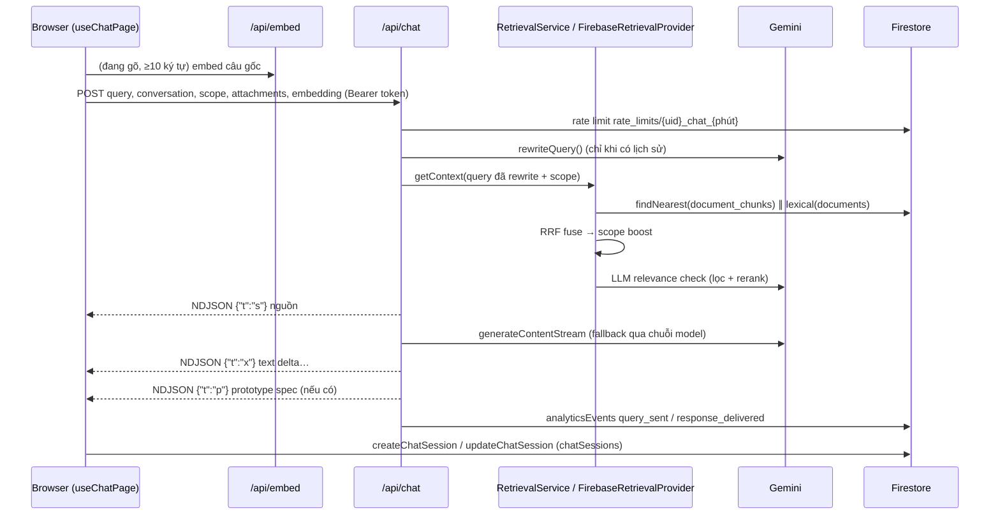

# Onboarding — người mới vào dự án

Lộ trình đi từ "chưa biết gì" tới "tự sửa code và đưa lên live". Đi đúng thứ tự: mỗi bước dựa trên bước trước. Ước lượng: 1–2 ngày.

Tài liệu này chỉ dẫn đường. Chi tiết nằm ở các doc được link tới; khi doc và code lệch nhau thì **code là sự thật**, và hãy sửa doc trong cùng PR.

---

## Bước 0 — Bản đồ tài liệu

| Thứ tự đọc | Tài liệu | Đọc để biết |
|---|---|---|
| 1 | `README.md` | Dự án là gì, chạy local thế nào |
| 2 | **File này** | Lộ trình, luồng chính, quy ước |
| 3 | `docs/PROJECT_OVERVIEW.md` | Tài liệu gốc: kiến trúc, API, data model, security, env (mục 9), troubleshooting (mục 11) |
| 4 | `docs/UI_AND_THEME.md` | Token CSS, Tailwind v4, pattern UI. (`docs/DESIGN.md` chỉ là cảm hứng, **không** map 1:1 với code) |
| 5 | `docs/ANALYTICS_REPORTS.md` | Event telemetry và dashboard `/admin/reports` |
| 6 | `src/lib/retrieval/eval/BASELINE.md` | Số đo retrieval; **bắt buộc** đọc trước khi đụng tới `RETRIEVAL_*` |
| 7 | `docs/HUONG_DAN_LEN_LIVE.md` → `docs/RELEASE_PROCESS.md` | Đưa thay đổi lên production |
| Khi cần | `docs/FIREBASE_DEPLOY.md`, `docs/PRE_LIVE_ENV_CHECKLIST.md` | Dựng project Firebase mới, audit env |
| Lịch sử | `docs/tasks/*` | PRD + task list đợt nâng cấp retrieval (đã xong, chỉ để tra cứu) |
| Agent / AI | `AGENTS.md`, `CLAUDE.md`, `graphify-out/GRAPH_REPORT.md` | Quy ước cho coding agent; knowledge graph của code |

---

## Bước 1 — Hiểu sản phẩm (30 phút)

**Internal Knowledge Chat** là trợ lý nội bộ "Zalo Content Guidelines": user hỏi bằng tiếng Việt, bot trả lời dựa trên kho tài liệu guideline nội bộ (RAG trên Firestore + Gemini). Bot làm hai việc:

- **Tra cứu guideline:** "dấu hai chấm dùng thế nào?"
- **Soạn microcopy UX:** "viết snackbar báo lỗi gửi ảnh thất bại", kèm **bản dựng minh hoạ** giống màn Zalo thật (PROJECT_OVERVIEW 5.6).

Ba role (`users/{uid}.role`):

| Role | Được làm |
|---|---|
| `user` | Chat, xem lịch sử, xem tài liệu nguồn, quản lý phiên đăng nhập của mình (`/account/sessions`) |
| `contributor` | Thêm: upload/sửa tài liệu (`/admin/library`, `/admin/upload`), xem `/admin/reports` |
| `admin` | Thêm: quản lý user (`/admin/users`): tạo, đổi role, reset mật khẩu, khoá, xoá, đăng xuất phiên từ xa, sửa liên hệ ở trang login |

Không có đăng ký công khai: admin cấp tài khoản, user đăng nhập bằng **username + password**. Phía sau, username được đổi thành email giả `{username}@{INTERNAL_AUTH_EMAIL_DOMAIN}` cho Firebase Auth.

**Việc cần làm:** xin admin một tài khoản `contributor` trên production, rồi dùng thử: hỏi 1 câu guideline, 1 câu microcopy, bấm vào nguồn, xem `/admin/library` và `/admin/reports`.

---

## Bước 2 — Chạy local (1 giờ)

### 2.1 Chuẩn bị

- Node 20+ và npm.
- Firebase CLI (`npm i -g firebase-tools`), chỉ cần khi deploy rules/app.
- Quyền vào Firebase project (Console) để lấy config.

> ⚠️ **Repo không dùng Firebase Emulator.** `npm run dev` kết nối thẳng tới project Firebase ghi trong `.env.local`. Nếu đó là production, mọi thao tác (chat, upload, xoá tài liệu, tạo user) đều là **dữ liệu thật**. Tốt nhất là xin một project dev/staging riêng. Nếu buộc phải dùng production, chỉ dùng tài khoản test và đừng xoá hoặc sửa tài liệu của người khác.

### 2.2 Cài và cấu hình

```bash
npm install
cp .env.example .env.local
```

Điền `.env.local`:

| Biến | Lấy ở đâu |
|---|---|
| `NEXT_PUBLIC_FIREBASE_*` (6 biến) | Firebase Console → Project settings → Web app config |
| `NEXT_PUBLIC_INTERNAL_AUTH_EMAIL_DOMAIN` = `INTERNAL_AUTH_EMAIL_DOMAIN` | Giữ `accounts.internal` (hai biến phải **bằng nhau**, nếu khác thì server không khởi động) |
| `GEMINI_API_KEY` | Hỏi lead dự án, hoặc tự tạo ở AI Studio (key loại Auth `AQ.…`, xem PROJECT_OVERVIEW mục 11) |
| `FIREBASE_SERVICE_ACCOUNT_KEY` | JSON service account viết trên **một dòng**. Hỏi lead dự án; đừng commit, đừng gửi qua chat |
| `CHAT_ATTACHMENTS_CRON_SECRET` | Local có thể để trống (chỉ route cron dùng tới) |

Danh sách đầy đủ biến và giá trị mặc định: PROJECT_OVERVIEW mục 9.

### 2.3 Chạy

```bash
npm run validate:env   # chỉ kiểm tra cặp domain auth trong .env/.env.local
npm run dev            # http://localhost:3000 (webpack; `npm run dev:turbo` để thử Turbopack)
```

Lần đầu trên project trống, phải tạo admin bằng tay (FIREBASE_DEPLOY mục 3.1). Firestore `users/{uid}` phải có **document ID bằng UID của Auth**.

### 2.4 Kiểm tra

```bash
npm test               # Vitest, chạy nhanh, không cần mạng
npm run lint
npm run build
npx playwright test    # e2e: cần app đang chạy + export E2E_USER_*/E2E_ADMIN_* trong shell
```

E2E không tự đọc file env. Thiếu tài khoản test thì các test cần đăng nhập sẽ bị **skip âm thầm**. Muốn bật test gọi model thật thì đặt `E2E_RUN_LLM_TESTS=1`.

---

## Bước 3 — Đọc code theo luồng (3–4 giờ)

Đừng đọc theo thư mục. Hãy đi theo 4 luồng dưới đây, mở từng file theo thứ tự.

### Bản đồ thư mục

```
src/app/            Route Next.js: trang + API (src/app/api/**/route.ts)
src/components/     UI: chat/ (màn chat, prototype/), landing/, reports/, panel admin
src/hooks/          Logic client của màn chat và reports (useChatPage là trung tâm)
src/lib/            Business logic, không phụ thuộc UI
  retrieval/        Vector + lexical + RRF + relevance check (+ eval/)
  documents/        Chunking, embedding, sanitize HTML
  chat/             Stream NDJSON, query rewrite, scope, prototype spec
  reports/          Tính metric dashboard
  env/              Validate env
src/context/        AuthContext (role, phiên), ThemeContext
src/middleware.ts   Chặn page khi thiếu cookie __session (chỉ để điều hướng, không phải bảo mật)
scripts/            Script vận hành Node (eval, reindex, migrate, set-password); scripts/lib/ là bản JS của logic retrieval
e2e/                Playwright
firestore.rules, storage.rules, firestore.indexes.json   Bảo mật và index, deploy riêng (không đi theo rollout app)
```

### Luồng 1 — Đăng nhập và phân quyền

1. `src/middleware.ts`: thiếu cookie thì redirect sang `/login?next=…`.
2. `src/app/login/page.tsx` (đọc liên hệ từ `settings/accountContact`) → `LoginClient.tsx` (username → email, `signInWithEmailAndPassword`).
3. `src/context/AuthContext.tsx`: **nơi quyết định** user có được vào hay không. Đọc `users/{uid}` (timeout 10s, thử 2 lần), set cookie `__session`, đăng ký `authSessions`, nghe sự kiện bị revoke.
4. `src/components/ProtectedRoute.tsx`: chặn role ở UI.
5. `src/lib/api-request-auth.ts`: chặn ở server (`requireUidFromRequest`, `requireAdmin`, `requireContributorOrAdmin`).
6. `firestore.rules`, `storage.rules`: lớp bảo mật thật cho mọi truy cập từ client.

Đọc thêm PROJECT_OVERVIEW 4.3, 7, 8.4, 8.5. Mục 8.4 và 11 ghi lại vài bug login đã gặp (`window.location.assign`, logout race), nên đọc trước khi sửa phần này.

### Luồng 2 — Một câu hỏi chat (luồng quan trọng nhất)



File theo thứ tự:

1. `src/app/chat/page.tsx` → `src/hooks/useChatPage.ts` (gửi, stream, New Chat) → `useChatSession.ts` (lưu Firestore qua `src/lib/chatHistory.ts`) → `useChatAttachments.ts`.
2. `src/lib/chat/stream.ts`: parse NDJSON phía client.
3. `src/app/api/chat/route.ts`: toàn bộ pipeline server, nên đọc kỹ.
4. `src/lib/chat/query-rewrite.ts`, `src/lib/chat/scope-options.ts`.
5. `src/lib/RetrievalService.ts` (prompt hệ thống, gọi model) → `src/lib/retrieval/FirebaseRetrievalProvider.ts` (`search()`) → `chunkMerge.ts`, `rrf.ts`, `llm-relevance-check.ts`, `excerptBudget.ts`, `queryTerms.ts`.
6. Bản dựng minh hoạ: `src/lib/chat/prototype-spec.ts` → `prototype-extract.ts` → `src/components/chat/prototype/patterns.tsx`.

Đọc thêm PROJECT_OVERVIEW 5.1, 5.5, 5.6, 8.1.

### Luồng 3 — Đưa tài liệu vào kho tri thức

1. `src/app/admin/upload/page.tsx`: upload file lên Storage `documents/…`, tạo doc `documents` (status `processing`), gọi `/api/ingest`.
2. `src/app/api/ingest/route.ts`: extract text (PDF qua Gemini, DOCX qua mammoth, TXT/CSV), sau đó `writeDocumentChunks()`.
3. `src/lib/documents/chunking.ts` (chunk ~1800 ký tự kèm `headingPath`) → `embeddings.ts` (`gemini-embedding-2`, 1536 chiều) → collection `document_chunks`.
4. Inline doc (soạn trực tiếp trong app): `src/components/InlineDocumentEditor.tsx` → `/api/documents/inline[/id]` (sanitize, rồi chunk + embed lại) và `/api/upload/image`.
5. Xem tài liệu: `src/app/references/[id]/page.tsx` → `/references/file/[id]` (có CSP, PROJECT_OVERVIEW 5.7, 7.4).

Đọc thêm PROJECT_OVERVIEW 5.2, 6.2, 6.2b, 8.2.

### Luồng 4 — Quản trị và đo lường

- Users: `src/app/admin/users/page.tsx` → `/api/admin/users[/uid]` → `src/lib/admin-users.ts`, `admin-auth-sessions.ts`.
- Telemetry: `src/lib/analytics-events.ts` (whitelist event), server ghi trong các route, client ghi qua `/api/events`.
- Dashboard: `src/app/admin/reports/page.tsx` → `useAnalyticsReportsData.ts` → `/api/admin/reports` → `src/lib/reports/*` (bao gồm chi phí LLM: `llm-usage.ts`, `gemini-pricing.ts`).

Đọc thêm `docs/ANALYTICS_REPORTS.md`.

---

## Bước 4 — Quy ước bắt buộc khi sửa code

1. **Next.js 16 khác với kiến thức cũ.** Trước khi dùng API Next, đọc doc tương ứng trong `node_modules/next/dist/docs/` (`AGENTS.md`). Ví dụ: `middleware.ts` đã được đổi tên thành `proxy.ts` ở Next 16, nhưng repo vẫn dùng tên cũ.
2. **Logic retrieval có hai bản.** Sửa `src/lib/retrieval/*` hoặc `src/lib/documents/chunking.ts` thì phải sửa bản JS tương ứng trong `scripts/lib/`. Nếu quên, `mirror-drift.test.ts` sẽ fail.
3. **Đổi tham số retrieval phải đo.** Chạy `node scripts/eval-retrieval.mjs`, so với `BASELINE.md`, rồi ghi kết quả mới vào đó. Không tăng `RETRIEVAL_RRF_WEIGHT_LEXICAL` lên > 0 (đã đo là làm giảm chất lượng).
4. **Script trong `scripts/` dùng credential production** từ `.env.local`. Các script có ghi chú "Ghi production" (`reindex-embeddings`, `migrate-heading-path`, `set-password`) thì chạy `--dry-run` trước nếu có, và báo team trước khi chạy.
5. **Bảo mật nằm ở server và rules**, không nằm ở UI. Route mới phải gọi `requireUidFromRequest` (và guard role nếu cần), thêm `checkRateLimit` nếu route tốn tiền. Collection mới phải có rule trong `firestore.rules`.
6. **Không render HTML do model sinh ra.** Bản dựng minh hoạ chỉ nhận dữ liệu qua Zod schema. Thêm pattern UI thì thêm vào `scope-options.ts`; khi đó `patterns.tsx` bắt buộc phải có component tương ứng, không thì tsc fail.
7. **Màu và token** lấy từ `src/app/globals.css` qua class semantic (`bg-surface`, `border-border`…). Không hard-code hex.
8. **Code style** (`CLAUDE.md`): hàm nhỏ, tên rõ ràng, tách business logic (`src/lib`) khỏi UI, không trừu tượng hoá thừa. Test đặt cạnh file (`*.test.ts`); file cần DOM thì thêm `// @vitest-environment jsdom`.
9. **Doc đi cùng code.** Đổi API, env, collection hay rule thì cập nhật `PROJECT_OVERVIEW.md` trong cùng PR. Sau khi sửa code, chạy `graphify update .` để làm mới knowledge graph.

---

## Bước 5 — Thay đổi đầu tiên → production

1. Tạo branch từ `main` (`feat/…`, `fix/…`, `docs/…`).
2. Sửa code và test (`npm test`, `npm run lint`, `npm run build`), rồi smoke test local đúng luồng vừa sửa.
3. Mở PR vào `main`. Merge đồng nghĩa với rollout production: App Hosting tự build từ `main`.
4. Nếu đổi `firestore.rules`, `storage.rules` hoặc `firestore.indexes.json`, chạy thêm `firebase deploy --only firestore:rules,firestore:indexes,storage`, vì rollout app **không** deploy các file này.
5. Nếu đổi env hoặc secret: biến thường đặt ở Console; secret thì dùng `firebase apphosting:secrets:set`, **không bao giờ** nhập literal vào Console. Sau đó phải rollout lại (PROJECT_OVERVIEW 9.1).
6. Theo dõi Firebase Console → App Hosting → Rollouts cho tới khi `Succeeded`, rồi smoke test production (`HUONG_DAN_LEN_LIVE.md` bước 5).
7. Có lỗi thì rollback ở Console → Rollouts.

Gợi ý bài tập đầu tiên (nhỏ, an toàn): sửa một copy trên landing (`src/app/page.tsx`), hoặc thêm một unit test cho `src/lib/chat/scope-options.ts`.

---

## Bước 6 — Tự kiểm tra

Nếu trả lời được các câu dưới đây mà không cần mở doc, bạn đã nắm được dự án:

1. Vì sao middleware không phải lớp bảo mật? Lớp bảo mật thật nằm ở đâu?
2. User đăng nhập đúng mật khẩu nhưng bị báo "chưa được cấp quyền". Nên kiểm tra gì?
3. Một lượt chat gọi Gemini mấy lần, cho những việc gì?
4. Vì sao lexical search vẫn chạy nhưng trọng số RRF của nó bằng 0?
5. Bot trả "chưa có guideline" cho một câu lẽ ra có trong tài liệu. Debug thế nào?
6. Sửa `queryTerms.ts` xong mà `npm test` fail ở `mirror-drift`. Vì sao?
7. Rotate `GEMINI_API_KEY` xong production vẫn lỗi 500. Nguyên nhân hay gặp là gì?
8. Thêm một kiểu UI mới cho bản dựng minh hoạ thì phải sửa những file nào?

Đáp án nằm ở PROJECT_OVERVIEW 4.3, 5.5, 7, 9.1, 11 và Bước 4 ở trên.

---

## Tra nhanh: "Muốn làm X thì xem Y"

| Muốn… | Xem |
|---|---|
| Sửa prompt / cách bot trả lời | `src/lib/RetrievalService.ts`, `src/app/api/chat/route.ts` |
| Đổi model Gemini | `src/lib/gemini-models.ts`, env `GEMINI_CHAT_MODELS`; giá token ở `src/lib/gemini-pricing.ts` |
| Bot tìm sai tài liệu | `src/lib/retrieval/*`, `BASELINE.md`, `scripts/eval-retrieval.mjs` |
| Thêm loại file upload | `src/app/api/ingest/route.ts`, `src/app/admin/upload/page.tsx` |
| Thêm event analytics | `src/lib/analytics-events.ts`, `docs/ANALYTICS_REPORTS.md` |
| Thêm route API | Copy guard từ một route có sẵn (`api-request-auth.ts`, `rate-limit.ts`), rồi thêm vào bảng ở PROJECT_OVERVIEW 5.10 |
| Thêm collection Firestore | `firestore.rules`, `firestore.indexes.json` nếu cần query, PROJECT_OVERVIEW mục 6 |
| Đổi giao diện, theme | `src/app/globals.css`, `docs/UI_AND_THEME.md` |
| Reset mật khẩu admin | `/admin/users` → đổi mật khẩu của mình, hoặc `node scripts/set-password.mjs <username>` |
| Lỗi production | PROJECT_OVERVIEW mục 11, App Hosting → Logs |
